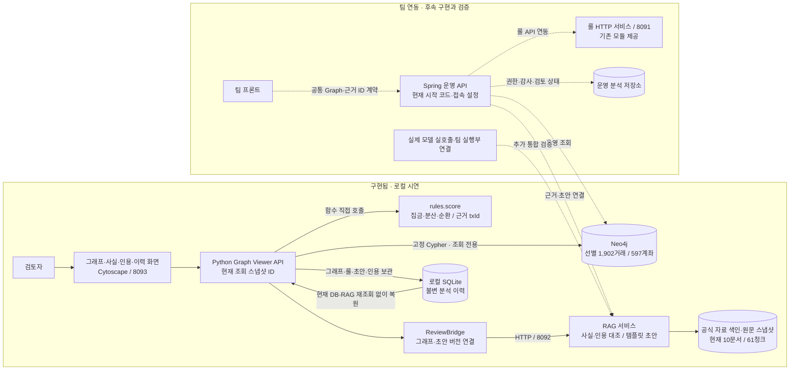

# TraceOn 아키텍처 한 장

2026-11-23 코드 기준. **실선은 구현된 로컬 시연 경로**, 점선은 팀 연동에서 구현·검증할 경로다. 운영 DB 접근 책임은 Spring에 둔다.

| 데이터가 이어지는 기준 | 현재 구현의 의미 |
|---|---|
| `txId` → 그래프 선 → 룰 `evidenceTxIds` → 사실 근거 | ID·방향·금액 문자열·통화·시각 보존. 브라우저가 점수·그래프·초안을 주입하지 않고 서버 ID로 연결 |
| 추가 조회 → 새 `reviewSnapshotId` | 69→72건으로 갱신하고 룰 재계산, 이전 초안 무효화. 대상 시점·7일·2홉 고정 |
| Context/Report ID·그래프/코퍼스/원문 해시 | 동일 입력의 사실·인용·제어형 본문 대응 검사. 현재 로컬 경로는 `template`, LLM 호출 0회 |
| 저장 묶음 → 당시 그래프·룰·초안·인용 본문 | 새 서비스에서도 복원. `currentSourcesChecked=false`, 사람 검토 필수·최종 제출 불가 |

**평가 경로는 별도다.** 전체 원천 5,078,345거래의 SQLite 인덱스는 오프라인 평가 준비용이다. 기존 500건 대조는 필요한 131,089거래를 별도 Neo4j에 적재한 재현 검사이며 위 시연 DB와 다르다. 룰·ML 결합 모듈은 오프라인 연구 비교 상태이고 현재 화면 점수에 연결되지 않았다. [평가 범위·수치](presentation-evidence.md).

추가 로컬 변경에는 [Agent Python 도구](agent-review-workflow.md)의 식별→근거→템플릿→검증 및 제한된 생성 재시도가 구현돼 있다. 위 화면의 `ReviewBridge`는 기존 HTTP 템플릿 경로를 유지하며 이 새 실행부나 실제 모델의 화면 연결 완료를 뜻하지 않는다.

구현 근거: [조회·직접 룰 호출](../graph-viewer/server.py) · [계좌 추가](../graph-viewer/account_expansion.py) · [RAG 연결](../graph-viewer/review_bridge.py) · [저장·복원](../graph-viewer/analysis_history.py) · [SQLite](../graph-viewer/history_store.py) · [Spring 시작 코드](../backend/src/main/java/com/traceon/TraceonApplication.java). 로컬 API·저장은 확인됐으며 팀 Spring 전체 흐름의 완료를 뜻하지 않는다.
