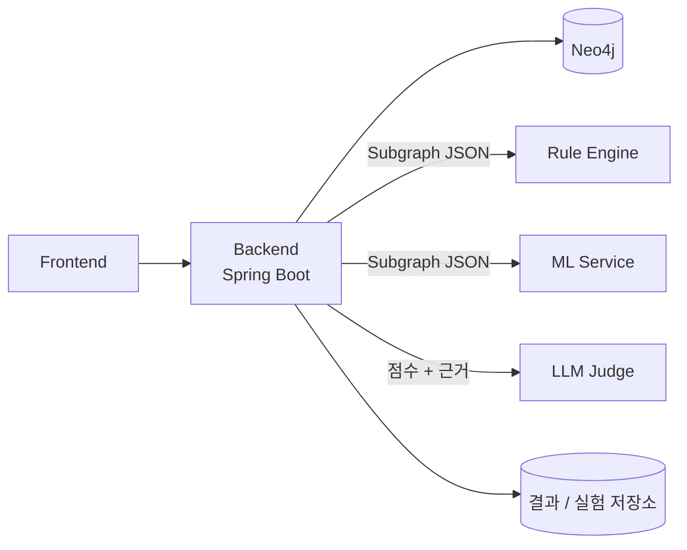

# 아키텍처

## 전체 구조 (결정: ADR-001, A안)



- 백엔드만 Neo4j에 접근하고 Subgraph를 만든다.
- Rule / ML / LLM은 상태 없이 입력을 받아 결과만 반환한다.
- Hybrid 점수 계산, 위험 등급 분류, 결과·실험 저장은 백엔드가 담당한다.

## Hybrid 처리 흐름

```text
HybridController
→ HybridService
→ GraphService (Subgraph 추출)
→ RuleDetectionClient ┐ (병렬 가능)
→ MLScoringClient     ┘
→ HybridScorer (정규화 + 가중합 + 등급)
→ LlmJudgeClient (점수는 변경하지 않고 설명만 생성)
→ ResultRepository
→ HybridResult 반환
```

## 미확정 사항

- 탐지 단위 (계좌 / 거래 / Subgraph) 및 라벨 기준
- Rule Engine 구현 언어와 배포 형태 (백엔드 내부 vs 별도 서비스)
- LLM Judge 구현 위치와 담당자
- Neo4j 노드·관계 스키마
