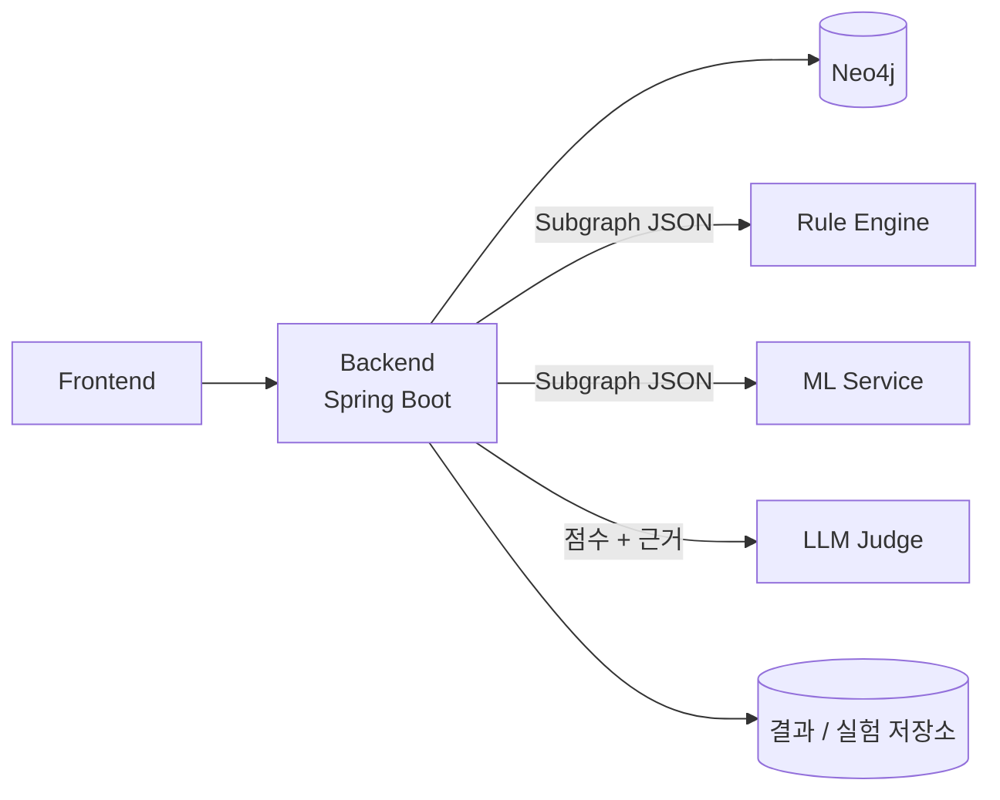

# 아키텍처

## 전체 구조 (결정: ADR-001, A안)



- 백엔드만 Neo4j에 접근하고 Subgraph를 만든다.
- Rule / ML / LLM은 상태 없이 입력을 받아 결과만 반환한다.
- Hybrid 점수 계산, 위험 등급 분류, 결과·실험 저장은 백엔드가 담당한다.

## Hybrid 처리 흐름

```text
HybridController
→ HybridService
→ GraphService (Subgraph 추출)
→ RuleDetectionClient ┐ (병렬 가능)
→ MLScoringClient     ┘
→ HybridScorer (정규화 + 가중합 + 등급)
→ LlmJudgeClient (점수는 변경하지 않고 설명만 생성)
→ ResultRepository
→ HybridResult 반환
```

## 현재 구현과 남은 통합

- 탐지·평가 단위는 거래이고, Neo4j 스키마는 `Account-TRANSFER->Account`다 (ADR-006).
- Python 룰 모듈·로컬 HTTP API와 DB 담당자의 적재·조회 검증 도구가 구현되어 있다.
- 1차 Neo4j 검증은 시연용 거래 1,902건·계좌 597개에 대해 수행했다. 2차 500건 평가는 원천 전체의 오프라인 인덱스에서 공통 그래프를 추출했다.
- RAG의 공식 문서 검색·거래 사실 검증·대표/보조 인용·검토 초안 API가 구현되어 있다. 실제 Neo4j 12사례의 관리자 연동 검사를 수행했다.
- Spring 운영 Graph API, 전체 평가의 Neo4j 조회 연결, ML 점수 결합, 실제 LLM 호출과 화면 시각화는 남아 있다. 현재 기본 검토 초안은 검산된 사실과 문구로 생성한다.
- 사용자 흐름은 의심거래 선택 → 연결 계좌·송금 경로 표시 → 의심 경로 강조 → 점수·근거 확인 → 보고서 확인이다.
- 담당별 상세 상태와 우선순위는 [RAG 담당 현황](rag-owner-status.md), [DB·룰 작업 기록](db-owner-status.md)에 기록한다. 팀 실행 순서는 [공유 안내](team-handoff.md)를 따른다.
